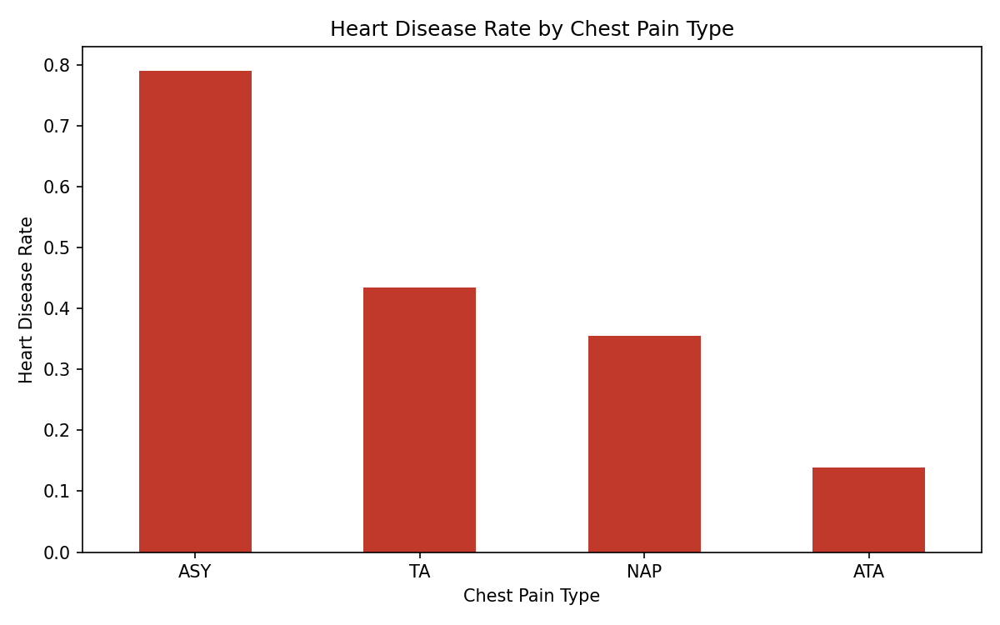
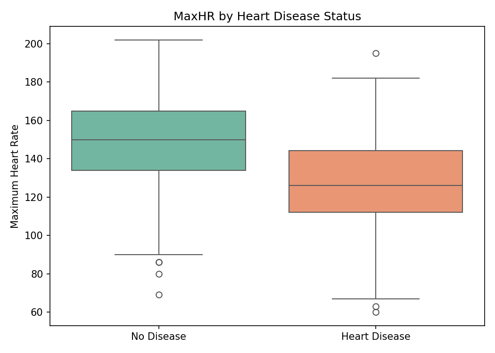

# data-science-project

# Heart Disease Risk Factor Analysis

## 1. Problem / Research Question
Which clinical features are most strongly associated with the presence of heart disease?

## 2. Dataset Source and Usage Permissions
- **Source:** The dataset used in this analysis is the publicly available **Heart Disease UCI Dataset** obtained from Kaggle (`heart.csv`, containing 918 records and 12 clinical features).
- **Usage Permissions:** This is an open-access dataset used strictly for academic learning, exploratory data analysis practice, and data science portfolio demonstration. It contains anonymized clinical records with no personally identifiable information (PII).

## 3. Methods and Tools Used
- **Programming Language:** Python 3
- **Data Manipulation & Aggregation:** `pandas` (used for data inspection and group-by statistical aggregation)
- **Data Visualization:** `matplotlib` and `seaborn` (used for generating bar charts and boxplots to compare clinical feature distributions)

## 4. Key Findings and Limitations

### Key Findings
1. **Significant Variation Across Chest Pain Types:** There is a marked difference in heart disease prevalence across different chest pain categories. Patients with **Asymptomatic (ASY)** chest pain exhibit the highest rate of heart disease (nearly 79%), followed by Typical Angina (TA) and Non-Anginal Pain (NAP), whereas Atypical Angina (ATA) shows the lowest rate.
   
   

2. **Lower Maximum Heart Rate in Heart Disease Patients:** The boxplot distribution demonstrates that the **Heart Disease** group has a noticeably lower overall Maximum Heart Rate (`MaxHR`, median ~126 bpm) compared to the **No Disease** group (median ~150 bpm).
   
   

### Limitation
This dataset is a publicly derived, composite dataset with a relatively limited sample size ($N = 918$), and certain public versions are known to contain duplicate records or cohort selection biases. Therefore, these findings should be interpreted strictly as exploratory and demonstrative results rather than definitive evidence for real-world clinical decision-making.

## 5. Instructions for Running the Analysis
1. Install the required packages: `pip install -r requirements.txt`
2. Download `heart.csv` from Kaggle and put it in the same folder as the notebook.
3. Open `heart_analysis.ipynb` and run all cells sequentially.
